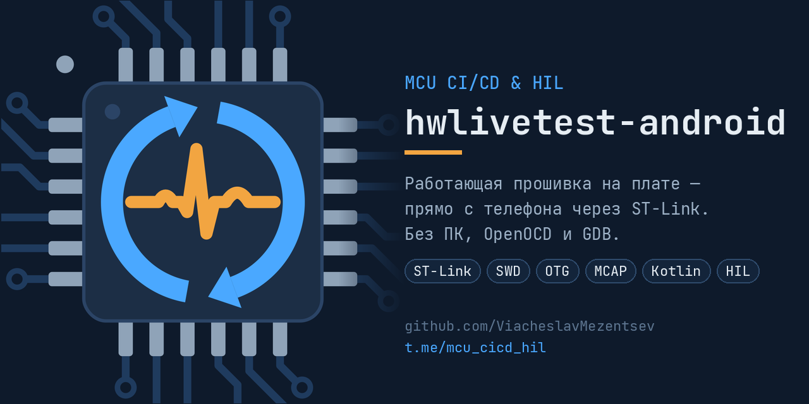

# HW Live Test (Android)



Диагностика микроконтроллера, работа с прошивкой и графики сигналов прямо с телефона.
ST-Link подключается через USB OTG; приложение использует собственный протокол на Kotlin
поверх Android USB Host API. Termux, OpenOCD и GDB не нужны.

[Сайт](https://viacheslavmezentsev.github.io/hwlivetest-android/) ·
[Релизы и APK](https://github.com/ViacheslavMezentsev/hwlivetest-android/releases) ·
[Описания версий](docs/releases/README.md) · [Запланированное — TODO](TODO.md)

## Что нужно

- Телефон с Android 8.0+ и поддержкой USB Host (OTG).
- ST-Link V2, V2-1 или V3, OTG-переходник и подключённая по SWD плата.
- Доступ к отладочному интерфейсу MCU; защита устройства может ограничивать чтение.

Подключение общее для экранов: переход между ними не требует повторного подключения.
Интерфейс на Jetpack Compose поддерживает светлую и тёмную темы и поворот экрана.

## Диагностика одним нажатием

В простом режиме кнопка **«ПУСК»** подключается к адаптеру, опознаёт MCU и проверяет:

- связь, версию ST-Link и напряжение платы, если адаптер его измеряет;
- работу, остановку, сон и блокировку ядра;
- активные исключения и доступные регистры сбоев;
- положение PC, если ядро поддерживает выборку и она уже включена;
- начало Flash, таблицу векторов, защиту и тактирование — в зависимости от профиля MCU.

Результаты показываются компактно; подробности раскрываются по нажатию.
Проверка начала Flash **не измеряет заполненность всей памяти**.
Точный состав чтений описан в [эвристиках](docs/heuristics.md).

## Экспертный режим

При входе открывается **«Устройство»**. Порядок вкладок:
**Устройство → Прошивка → Сигналы → Журнал**. Между ними можно переключаться
нажатием или свайпом.

### Устройство

- Свойства адаптера и микроконтроллера, текущее состояние ядра.
- Автоматический профиль известного MCU или общий профиль Cortex-M.
- Ручной выбор Cortex-M либо STM32F1/F4/G4-совместимого профиля для проверок чтением.
  Он действует до отключения и не подменяет DEV_ID или размеры памяти.
- Остановка, запуск, сброс с запуском или остановкой и импульс NRST при включённом доступе.
- Страница **«Модуль ST-Link»**: версия прошивки адаптера, график приёма и передачи,
  объём обмена и измеренный пик скорости. Теоретический предел скорости не определяется.

Для неизвестного MCU общий профиль не предполагает карту памяти STM32.
Набор проверок зависит от ядра и доступности регистров; наличие Cortex-M само по себе
не означает поддержку прошивки. Аппаратные проверки прошивки выполнены на F103 и F411.

### Прошивка

- Загрузка Intel HEX и ELF, предварительный расчёт затронутых секторов.
- Сохранение полной Flash в HEX при известной карте и размере, без остановки ядра.
- Сверка содержимого устройства с выбранным файлом.
- Прошивка поддерживаемых STM32F1 и STM32F4: резервная копия, стирание, запись,
  обязательная сверка и необязательный запуск.
- Отдельное стирание области выбранного файла или всей Flash.
- Прогресс, отмена операции, результат и отправка отчёта.
- Извлечение таблицы сигналов из ELF/DWARF; она подключается после подтверждения,
  что образ в устройстве совпадает с ELF.

Реализованы контроллеры Flash для DEV_ID F1: `0x410`, `0x412`, `0x414`;
F4: `0x413`, `0x419`, `0x423`, `0x431`, `0x433`.
Для записи также нужны известный размер Flash и подходящие параметры операции.
Ручной совместимый профиль не добавляет неизвестный MCU в этот список.

Отдельное стирание удаляет целиком затронутые сектора, включая данные вне выбранного
образа. Перед обычной прошивкой запускать его не нужно: нужные сектора стираются автоматически.

### Сигналы и графики

- Загрузка `addresses.json`, поиск, фильтры по типу и группировка полей.
- Живые значения и зелёный индикатор свежего успешного чтения.
- До шести каналов на графике, интервалы 30 секунд, 1 минута и 5 минут.
- Масштабирование, пауза, общая или отдельные шкалы, текущие значения и статистика.
- Запись выбранных каналов в MCAP с профилем ROS 1 и сообщениями `std_msgs`,
  экспорт накопленного буфера и отправка файла.

На графике задан интервал опроса 100 мс; фактическая частота зависит от устройства
и обмена по USB и показывается на экране. Для общего профиля Cortex-M каждое выбранное
слово читается отдельно, без захвата соседних адресов.

### Журнал и настройки

На странице **«Журнал»** собраны действия, ответы, история операций и копирование журнала.
Подробный обмен USB и его запись при опросе включаются отдельно.

В настройках доступны:

- **Отладочные сведения** — адреса, регистры, символы ELF и чтение слова по адресу.
- **Резервная копия перед прошивкой** — включена по умолчанию.
- **Использовать SHA-256** — отображение хешей и проверка файла по введённой сумме;
  выключено по умолчанию. Обязательная сверка после записи от этой настройки не зависит.
- **Быстрые действия** — остановка, запуск и сброс ядра без повторного вопроса,
  после явного подтверждения режима.

По умолчанию приложение работает только на чтение. Для изменения устройства нужно
включить **«Доступ»** в разделе **«Управление»**. Прошивка, стирание и NRST сохраняют
подтверждения даже при быстрых действиях. Option bytes и защита Flash не изменяются.

Экран **«О программе»** показывает версию, коммит, происхождение и время сборки,
время установки и сведения о данных приложения.

## Формат addresses.json

Приложение читает массив `fields`. Его можно подготовить внешним инструментом,
например `resolve_addresses.py`, или использовать таблицу, извлечённую из ELF.

| Ключ | Как используется |
| :--- | :--- |
| `topic` | Имя поля и ключ; повторы пропускаются |
| `kind` | `float32`, `uint32`, `int32`, `uint32_seconds`; неизвестный тип трактуется как `uint32` с предупреждением |
| `address` / `address_hex` | Адрес 32-битного слова; требуется выравнивание на 4 |
| `min`, `max` | Значения вне границ отмечаются и не добавляются в ряд графика |
| `shift`, `mask` | Выделение поля из слова |
| `expr` | Выражение, показываемое в отладочных сведениях |

Для известной карты адреса проверяются по размерам Flash/SRAM. Выход за границы и
чтение периферии сопровождаются предупреждениями. Для общего профиля карта и границы
отмечаются как неподтверждённые. Последний открытый файл запоминается.

## Установка

Скачайте APK из [релиза](https://github.com/ViacheslavMezentsev/hwlivetest-android/releases),
откройте его на телефоне и разрешите установку из выбранного источника.
Подключите ST-Link через OTG и предоставьте приложению доступ к USB.

Для обновления поверх установленного приложения APK должен быть подписан тем же
сертификатом. Публикуемые локальные отладочные APK и сборки GitHub Actions могут иметь
разные сертификаты; сведения о конкретном APK приведены в описании релиза.

## Сборка

Нужны JDK 17+ и Android SDK. Версии инструментов закреплены в Gradle-проекте.

```shell
./gradlew test assembleDebug
```

В PowerShell используйте `./gradlew.bat test assembleDebug`.
APK создаётся в `app/build/outputs/apk/debug/`. Успешные запуски **Android CI**
также сохраняют APK в артефактах GitHub Actions.

## Документация и код

| Модуль | Назначение |
| :--- | :--- |
| `stlink` | Протокол ST-Link, опознание и профили Cortex-M, управление ядром |
| `usb` | Поиск адаптеров, разрешения Android USB и транспорт |
| `app` | Экраны и общее состояние подключения |
| `telemetry` | Разбор полей, опрос, ряды и оси графиков |
| `diag` | Диагностика «ПУСК» |
| `firmware` | HEX/ELF, резервная копия, сверка, запись и стирание |
| `recorder` | Запись MCAP |

[Архитектура](docs/architecture.md) ·
[ТЗ ST-Link](docs/spec/TECHNICAL_SPECIFICATION_STLINK.md) ·
[ТЗ прошивки](docs/spec/TECHNICAL_SPECIFICATION_FIRMWARE.md) ·
[Публикация сайта](docs/pages.md) · [История этапов](docs/roadmap.md).

Незавершённые возможности и аппаратные проверки перечислены в [TODO.md](TODO.md).

## Лицензия

MIT, см. [LICENSE](LICENSE).
